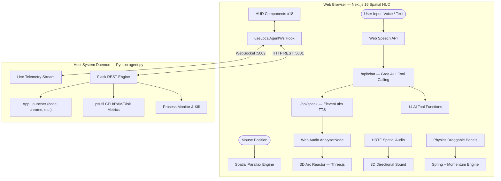

# J.A.R.V.I.S. — AI Voice Assistant & Spatial HUD

[](https://nextjs.org/)
[](https://react.dev/)
[](https://threejs.org/)
[](https://groq.com/)
[](https://www.python.org/)
[](LICENSE)

> An Iron Man-inspired **AI Voice Assistant & Interactive Spatial HUD** — with a live 3D arc reactor, voice-reactive particle systems, real-time OS telemetry, physics-based floating panels, HRTF spatial audio, and a Python desktop IPC daemon. Built with Next.js 16, Three.js WebGL, Web Audio API, and Groq AI.

🔗 **Live Demo:** [jarvis-theta-indol.vercel.app](https://jarvis-theta-indol.vercel.app)

---

## 🖼️ Screenshots

### Cyan Mode — Default Holographic HUD


> The default **Cyan theme** dashboard. The central 3D arc reactor glows with particle rings and orbiting energy bands. Surrounding panels display real-time system vitals (CPU 29.8%, RAM 49.2%, Disk 58%), audio visualizer waveforms, security status, satellite link coordinates, atmospheric data (26°C Overcast), system topology mesh, and a live process monitor. The **System Metrics Log** in the bottom-left traces every agent action in real time. J.A.R.V.I.S. greets: *"Good morning, Sir — Standing by for instructions."*

---

### Purple Mode — Voice Active / Responding State


> The **Purple / Teal theme** activates when the AI is speaking or processing. The arc reactor shifts to a deep violet-blue particle storm with expanded ring radius and intensified glow — driven live by the TTS audio FFT analyser. The System Metrics Log updates to show *"Wake sequence initiated"* and *"Monitoring assistant states..."* while the subtitle changes to *"Relaying response..."* — giving real-time visual feedback of the AI's activity state.

---

## 🎨 Themes & Visual Modes

Switch themes from the top-right status bar (`THEME: CYAN` button):

| Theme | Arc Reactor Color | Ring Color | Use Case |
|---|---|---|---|
| **Cyan** | Bright aqua-blue | Teal rings | Default / idle state |
| **Purple** | Violet-blue plasma | Magenta rings | Voice active / AI speaking |
| **Bright** | High-contrast white | White glow | High-ambient environments |

The theme propagates across **all HUD panels** simultaneously — colors, glows, border accents, and particle hues update in real time.

---

## ✨ Feature Overview

### 🎙️ AI Voice Engine
| Feature | Details |
|---|---|
| **Wake Word Detection** | *"Wake up Jarvis"* activates · *"Jarvis sleep"* suspends |
| **Always-On Listening** | Toggle persistent mic monitoring via `● ALWAYS LISTENING` indicator |
| **Streaming AI Chat** | Groq GPT-OSS 120B with 14 tool-calling functions |
| **Voice Synthesis** | ElevenLabs TTS (7 voice presets) with browser SpeechSynthesis fallback |
| **Conversation Memory** | Persistent `localStorage`-backed fact retention across sessions |

### 🌐 Central Arc Reactor (Three.js)
The centrepiece of the HUD — a fully 3D WebGL particle sphere that **reacts live to TTS audio**:

- **Bass frequencies** → outer glow intensity & pulse radius
- **Mid frequencies** → ring rotation speed & particle density
- **High frequencies** → particle burst flares & sparkle effects
- Idle state: slow breathing orbit animation
- Speaking state: full reactive audio-driven animation with expanded rings

### 🌌 Spatial UI System
| Feature | How It Works |
|---|---|
| **Parallax HUD** | Mouse position drives CSS perspective — background shifts ±20px, panels tilt ±1.5° |
| **Physics Panels** | Spring momentum on drag release, edge bounce, idle sine bob, magnetic snapping |
| **HRTF Spatial Audio** | `PannerNode` HRTF model maps screen click position → 3D directional sound |
| **Multi-Monitor Tracking** | Polls `window.screenX/Y` every 500ms, reports monitor quadrant (TL/TR/BL/BR) |

### 📊 HUD Panel Breakdown

| Panel | Location | What It Shows |
|---|---|---|
| **Neural Sync Link** | Top-left | Active audio waveform & sync ID |
| **Audio Visualizer** | Mid-left | Live microphone frequency bars |
| **Security Status** | Bottom-left | Firewall / Encrypt / Threat indicators |
| **System Vitals** | Upper-centre-left | CPU%, RAM%, Disk%, Uptime (live from agent) |
| **System Metrics Log** | Lower-centre-left | Real-time action/event log with timestamps |
| **Arc Reactor** | Centre | 3D voice-reactive WebGL particle sphere |
| **System Topology** | Centre-right | Animated 3D mesh grid — synced indicator |
| **Satellite Link** | Top-right | Globe icon + coordinates + orbital data |
| **Atmospheric Data** | Right | Live weather: temp (26°C), condition, humidity, wind |
| **System Terminal** | Bottom-centre | Boot/scan sequence log + interactive readout |
| **Process Monitor** | Bottom-right | Top CPU processes with live % bars |

### 🔧 14 AI Tool Functions

| Tool | What It Does |
|---|---|
| `search_web` | Real-time Google search via Serper API |
| `search_news` | Latest headlines via Serper News API |
| `get_weather` | Live weather from wttr.in |
| `get_location` | Reverse geocode browser coordinates |
| `search_wikipedia` | Wikipedia article summaries |
| `calculate` | Safe math expression evaluator |
| `set_timer` | Countdown timer with browser notifications |
| `set_reminder` | Delayed reminder notifications |
| `open_url` | Open websites in new tabs |
| `open_app` | Launch desktop apps via IPC agent |
| `control_volume` | System volume up/down/mute |
| `media_control` | Play/pause/next/previous media |
| `execute_system_command` | Run terminal commands (with safety filters) |
| `remember_fact` | Persist user preferences to memory |

### 🖥️ Desktop Agent (Python IPC)

The optional `agent.py` daemon unlocks real OS control over **WebSocket `:5002`** and **REST `:5001`**:

| Feature | Details |
|---|---|
| **App Launching** | VS Code, Chrome, Firefox, Terminal, VLC, Nautilus, Telegram |
| **Live Telemetry** | 1-second WebSocket stream: CPU%, RAM%, Disk%, uptime, active window |
| **Process Monitor** | View top processes, kill PIDs directly from HUD |
| **Volume / Media** | System volume and media playback control |
| **Command Execution** | Safe-filtered shell command execution |

> When connected, the status bar shows **● WS IPC STREAM** in green. When offline (e.g., Vercel), all AI, voice, weather, calculator, and timer features still work independently.

---

## 🏗️ System Architecture



---

## 🚀 Getting Started

### 1. Clone & Install
```bash
git clone https://github.com/nilanjanajui/jarvis.git
cd jarvis
npm install
```

### 2. Configure API Keys
Create `.env.local` in the project root:
```env
GROQ_API_KEY=your_groq_api_key          # Required — get from console.groq.com
SERPER_API_KEY=your_serper_api_key      # Required for web/news search
ELEVENLABS_API_KEY=your_elevenlabs_key  # Optional — falls back to browser TTS
```

### 3. Start Development Server
```bash
npm run dev
```
Open **http://localhost:3000** in Chrome or Edge.

### 4. Desktop Agent Setup (Optional)
To enable app launching, system metrics, and process control:
```bash
# In a separate terminal
python3 -m venv jarvis-env
source jarvis-env/bin/activate          # Windows: jarvis-env\Scripts\activate
pip install flask flask-cors psutil websockets
python agent.py
```
When connected, the HUD status bar shows **● WS IPC STREAM** in green.

---

## 🗣️ Voice Commands

| Say This | What Happens |
|---|---|
| *"Wake up Jarvis"* | Mechanical boot sequence + voice greeting |
| *"Jarvis sleep"* | Suspends always-on listening |
| *"What's the weather in Tokyo?"* | Fetches live weather data |
| *"Search for latest AI news"* | Returns news headlines |
| *"Open VS Code"* | Launches VS Code via agent daemon |
| *"What is 847 times 29?"* | Calculates and speaks result |
| *"Set a timer for 10 minutes"* | Creates countdown with notification |
| *"Remind me to call mom in 30 minutes"* | Schedules a reminder notification |
| *"Remember that my favorite color is blue"* | Saves to persistent memory |
| *"Who was Alan Turing?"* | Wikipedia lookup |

---

## 📂 Project Structure

```
jarvis/
├── src/
│   ├── app/
│   │   ├── page.js                 # Main HUD page (980+ lines)
│   │   ├── layout.js               # Root layout with fonts & metadata
│   │   ├── globals.css             # All CSS animations & design tokens
│   │   └── api/
│   │       ├── chat/route.js       # AI chat endpoint (14 tools, fallback models)
│   │       ├── speak/route.js      # ElevenLabs TTS proxy
│   │       ├── weather/route.js    # Weather API with geolocation
│   │       └── settings/route.js   # Settings persistence
│   ├── components/                 # 18 React components
│   │   ├── CenterHUD.jsx          # Central radar + reactor display
│   │   ├── ArcReactor3D.jsx       # Three.js voice-reactive particle sphere
│   │   ├── Draggable.jsx          # Physics-based drag with springs
│   │   ├── Navbar.jsx             # Navigation with spatial audio
│   │   ├── HudTools.jsx           # Calculator, Timer, Notebook, Process panels
│   │   ├── BioMetrics.jsx         # Neural sync & audio visualizer panels
│   │   └── ...                    # 12 more components
│   └── lib/                       # Shared utilities & hooks
│       ├── hudSounds.js           # Web Audio synthesized sound library
│       ├── spatialAudio.js        # HRTF 3D directional audio engine
│       ├── useSpatialMouse.js     # Mouse parallax tracking hook
│       ├── useWindowPosition.js   # Multi-monitor position detection
│       ├── useLocalAgentWs.js     # WebSocket + REST agent hook
│       ├── memory.js              # localStorage fact retention
│       ├── rateLimit.js           # API rate limiting utilities
│       └── voices.js              # ElevenLabs voice presets
├── agent.py                       # Python desktop IPC daemon
├── public/
│   ├── screenshot-cyan.png        # Dashboard screenshot — cyan theme
│   └── screenshot-purple.png     # Dashboard screenshot — purple theme
├── .env.local                     # API keys (not committed)
└── package.json
```

---

## ⚠️ Troubleshooting

| Issue | Solution |
|---|---|
| **"Agent Offline"** on Vercel | Expected — `agent.py` requires localhost. Run `npm run dev` locally |
| **Voice not working** | Use Chrome or Edge. Safari/Firefox lack Web Speech API support |
| **"Browser Voice"** instead of ElevenLabs | Check `ELEVENLABS_API_KEY` in `.env.local` or quota limits |
| **Weather errors** | Intermittent — wttr.in has occasional socket timeouts, auto-retries |
| **Panels stuck offscreen** | Click **RESET LAYOUT** in the status bar |
| **No process data** | Start `agent.py` — process monitor requires the local daemon |

---

## 🔒 Security & Privacy

- **Local-Only Agent**: `agent.py` binds exclusively to `127.0.0.1` — never exposed to the network
- **Command Filtering**: Destructive shell commands are filtered before execution
- **No Data Collection**: All conversation history and user facts stored in browser `localStorage` only
- **Graceful Degradation**: Works fully without agent daemon — AI, voice, weather, calculator, and timers all function independently

---

## 🛠️ Tech Stack

| Layer | Technology |
|---|---|
| **Framework** | Next.js 16 (App Router) + React 19 |
| **3D Rendering** | Three.js r186 (WebGL particle systems) |
| **Animation** | Framer Motion 12 (physics springs) |
| **Styling** | Tailwind CSS v4 |
| **AI Model** | Groq GPT-OSS 120B (tool calling) |
| **Voice Synthesis** | ElevenLabs TTS + Web SpeechSynthesis fallback |
| **Voice Input** | Web Speech API (Chrome/Edge) |
| **Audio Engine** | Web Audio API (AnalyserNode, PannerNode HRTF) |
| **Desktop Agent** | Python 3.12 · Flask · psutil · WebSockets |

---

## 📜 License

This is a personal project created and maintained by **Nilanjana Das Jui**. All rights reserved. No license is granted for copying, modifying, or distributing this project without the author's written permission.

---

**Built by [Nilanjana](https://github.com/nilanjanajui)** — Inspired by Tony Stark's J.A.R.V.I.S.
