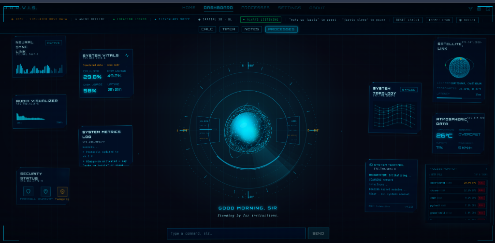
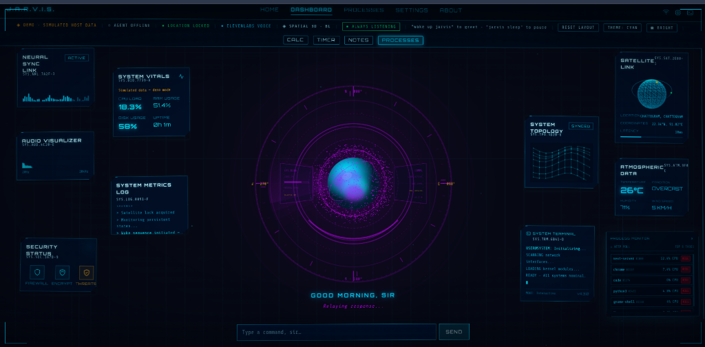

# J.A.R.V.I.S. — AI Voice Assistant & Spatial HUD

[](https://nextjs.org/)
[](https://react.dev/)
[](https://threejs.org/)
[](https://groq.com/)
[](https://www.python.org/)
[](LICENSE)

> An Iron Man-inspired **AI Voice Assistant & Interactive Spatial HUD** with multi-theme support, high-contrast readability mode, non-overlapping text command bar, hosted demo fallback, security hardening, live 3D Arc Reactor, and a Python desktop IPC daemon.

🔗 **Live Demo:** [jarvis-theta-indol.vercel.app](https://jarvis-theta-indol.vercel.app)

---

## 🖼️ Interface & Visual Modes

### Cyan Theme — Default Spatial HUD



> **Cyan Baseline Mode:** Live 3D WebGL particle sphere with orbiting energy rings, real-time telemetry (CPU, RAM, Disk, Uptime), audio visualizer waveforms, atmospheric readings, satellite tracking, system topology mesh, and an interactive command bar.

---

### Purple Theme — AI Speaking / Voice Reactive



> **Dynamic Voice & Theme Switcher:** Live reactive violet-blue particle storm driven by ElevenLabs TTS FFT analysis. HUD status displays *"Relaying response..."* and logs assistant lifecycle events in real time.

---

## 🌟 Key Updates & Enhancements

- ⌨️ **Dedicated Text Command Bar:**
  - Placed in its own dedicated flex container beneath the HUD radar—completely eliminating layout collision with central greetings and live responses.
  - Sits outside the clickable microphone area so typing and mouse interactions never accidentally trigger speech recognition.
  - Fully accessible keyboard navigation for browsers lacking Web Speech API support (e.g., Firefox).

- 🌐 **Vercel Hosted Demo Mode:**
  - Automatic detection when hosted away from `localhost` with an unreachable desktop daemon.
  - Smooth random-walk simulated telemetry metrics for CPU, RAM, and Disk in [BioMetrics.jsx](src/components/BioMetrics.jsx).
  - Explicit status indicator: `◈ DEMO · SIMULATED HOST DATA`.
  - Desktop-only actions (`open_app`, `volume`, `media`) log safe simulated notifications rather than failing network calls.

- 🎨 **Theme Engine & High-Contrast Readability Mode:**
  - **4 Palette Presets:** Cyan (`0deg`), Amber (`-150deg`), Green (`-70deg`), Violet (`+80deg`) with instant state persistence in `localStorage`.
  - **◉ BRIGHT / ○ DIM Mode:** Boosts card opacity (0.78), labels, borders, and navbar elements for clear visibility in bright rooms or low-contrast monitors.
  - **Visible Reactor Glow:** Radial status aura opacity tuned to `19%` for pronounced visual feedback on status transitions (`idle`, `listening`, `thinking`, `speaking`, `error`).
  - **Capped Response Display:** Central speech text capped cleanly to 3 lines with ellipsis overflow to prevent layout jumping during verbose AI answers.

- 🛡️ **Comprehensive Security Hardening:**
  - **Strict Loopback Binding:** Desktop daemon (`agent.py`) binds strictly to `127.0.0.1`.
  - **Origin & Host Header Validation:** Rejects unauthorized cross-origin requests.
  - **Shell Allowlist:** Prevents arbitrary command injection; runs only vetted, non-destructive tools.
  - **Safe URL Navigation:** Restricts outgoing links strictly to `http:` and `https:` schemes, preventing `javascript:` or `file:` URI vectors.
  - **API Rate Limiting:** Enforces request quotas across `/api/chat`, `/api/speak`, and `/api/weather`.

---

## 📐 System Architecture

```mermaid
flowchart TD

subgraph group_assistant["Assistant workflow"]
  node_app["Assistant page<br/>[page.js]"]
  node_chat["Chat and tools<br/>[route.js]"]
  node_tts["Speech synthesis route<br/>[route.js]"]
end

subgraph group_hud["Spatial HUD"]
  node_reactor["Center HUD and reactor<br/>[CenterHUD.jsx]"]
  node_reactor3d["3D Arc Reactor<br/>[ArcReactor3D.jsx]"]
  node_vitals["System vitals<br/>[BioMetrics.jsx]"]
  node_panels["HUD panels<br/>[SystemDrawer.jsx]"]
  node_tools["HUD tools<br/>[HudTools.jsx]"]
  node_settings["Settings<br/>[SettingsPanel.jsx]"]
end

subgraph group_services["Web services"]
  node_weather["Weather service<br/>[route.js]"]
  node_settingsapi["Settings API<br/>[route.js]"]
end

subgraph group_local["Local system"]
  node_daemonhook["Daemon connection hook<br/>[useLocalAgentWs.js]"]
  node_daemon["Python desktop daemon<br/>[agent.py]"]
end

node_user(("User"))
node_groq["Groq AI"]
node_speech["Speech recognition"]
node_eleven["ElevenLabs"]

node_user -->|"provides input"| node_app
node_speech -->|"transcribes voice"| node_app
node_app -->|"sends chat"| node_chat
node_chat -->|"requests completion"| node_groq
node_chat -->|"routes speech"| node_tts
node_app -.->|"requests audio"| node_tts
node_tts -->|"requests synthesis"| node_eleven

node_app -->|"renders HUD"| node_reactor
node_reactor -->|"renders reactor"| node_reactor3d
node_app -->|"renders telemetry"| node_vitals
node_app -->|"renders panels"| node_panels
node_app -->|"renders tools"| node_tools
node_app -->|"renders settings"| node_settings

node_settings -->|"fetches key status"| node_settingsapi
node_app -.->|"requests weather"| node_weather

node_app -->|"uses connection hook"| node_daemonhook
node_daemonhook -->|"HTTP and WebSocket"| node_daemon

click node_app "https://github.com/nilanjanajui/jarvis/blob/main/src/app/page.js"
click node_chat "https://github.com/nilanjanajui/jarvis/blob/main/src/app/api/chat/route.js"
click node_tts "https://github.com/nilanjanajui/jarvis/blob/main/src/app/api/speak/route.js"
click node_reactor "https://github.com/nilanjanajui/jarvis/blob/main/src/components/CenterHUD.jsx"
click node_reactor3d "https://github.com/nilanjanajui/jarvis/blob/main/src/components/ArcReactor3D.jsx"
click node_vitals "https://github.com/nilanjanajui/jarvis/blob/main/src/components/BioMetrics.jsx"
click node_panels "https://github.com/nilanjanajui/jarvis/blob/main/src/components/SystemDrawer.jsx"
click node_tools "https://github.com/nilanjanajui/jarvis/blob/main/src/components/HudTools.jsx"
click node_settings "https://github.com/nilanjanajui/jarvis/blob/main/src/components/SettingsPanel.jsx"
click node_weather "https://github.com/nilanjanajui/jarvis/blob/main/src/app/api/weather/route.js"
click node_settingsapi "https://github.com/nilanjanajui/jarvis/blob/main/src/app/api/settings/route.js"
click node_daemonhook "https://github.com/nilanjanajui/jarvis/blob/main/src/lib/useLocalAgentWs.js"
click node_daemon "https://github.com/nilanjanajui/jarvis/blob/main/agent.py"

classDef toneNeutral fill:#f8fafc,stroke:#334155,stroke-width:1.5px,color:#0f172a
classDef toneBlue fill:#dbeafe,stroke:#2563eb,stroke-width:1.5px,color:#172554
classDef toneAmber fill:#fef3c7,stroke:#d97706,stroke-width:1.5px,color:#78350f
classDef toneMint fill:#dcfce7,stroke:#16a34a,stroke-width:1.5px,color:#14532d
classDef toneRose fill:#ffe4e6,stroke:#e11d48,stroke-width:1.5px,color:#881337
classDef toneIndigo fill:#e0e7ff,stroke:#4f46e5,stroke-width:1.5px,color:#312e81
classDef toneTeal fill:#ccfbf1,stroke:#0f766e,stroke-width:1.5px,color:#134e4a

class node_app,node_chat,node_tts,node_user toneBlue
class node_reactor,node_reactor3d,node_vitals,node_panels,node_tools,node_settings toneAmber
class node_weather,node_settingsapi toneMint
class node_daemonhook,node_daemon toneRose
class node_groq,node_speech,node_eleven toneIndigo
```



---

## ⚡ HUD Panels & Navigation

| Component | Location | Functionality |
|---|---|---|
| **Center HUD & Arc Reactor** | Center | Three.js audio-reactive WebGL sphere, compass radar, greeting, status readout |
| **Command Bar** | Bottom Center | Dedicated input field with `SEND` button; keyboard-friendly |
| **System Vitals (BioMetrics)** | Left | CPU load, RAM usage, disk usage, uptime (live telemetry or demo simulation) |
| **System Metrics Log** | Left | Chronological event logs, state transitions, and diagnostic records |
| **Audio Visualizer & Neural Sync** | Left | Real-time audio waveform and frequency representation |
| **System Topology** | Right | Dynamic 3D wireframe network mesh |
| **Satellite Link** | Right | Orbital coordinates, latitude/longitude, and telemetry latency |
| **Atmospheric Data** | Right | Real-time temperature, condition, humidity, and wind speed via wttr.in |
| **Security Status** | Right | Firewall status, encryption level, and threat alerts |
| **System Terminal** | Right | Diagnostic initialization messages and pending command prompts |
| **Process Monitor (Modal)** | Popout | Top resource-consuming processes with PID termination capability |

---

## 🛠️ Tool Calling & Capabilities

The assistant orchestrates 14 specialized function calls:

1. `search_web`: Live internet searches via Serper API.
2. `search_news`: Latest headline queries.
3. `get_weather`: Geolocation-based atmospheric readings.
4. `get_location`: Reverse-geocoded coordinates.
5. `search_wikipedia`: Direct encyclopedia query extraction.
6. `calculate`: Safe mathematical expression parsing.
7. `set_timer`: In-browser countdown timers with desktop notifications.
8. `set_reminder`: Scheduled alerts and reminders.
9. `open_url`: Safely navigates verified web domains.
10. `open_app`: Launches permitted local software (VS Code, Chrome, Terminal, etc.).
11. `control_volume`: Manages system audio output levels.
12. `media_control`: Play, pause, skip, and rewind system media.
13. `execute_system_command`: Executes allowlisted shell routines via confirmation prompts.
14. `remember_fact`: Stores persistent user preferences and details to `localStorage`.

---

## 🚀 Getting Started

### 1. Repository Setup

```bash
git clone https://github.com/nilanjanajui/jarvis.git
cd jarvis
npm install
```

### 2. Environment Configuration

Create a `.env.local` file in the root directory:

```env
GROQ_API_KEY=your_groq_api_key          # Required: Core LLM logic
SERPER_API_KEY=your_serper_api_key      # Required: Web search & news
ELEVENLABS_API_KEY=your_elevenlabs_key  # Optional: High-fidelity voice (falls back to browser TTS)
```

### 3. Launch Development Server

```bash
npm run dev
```

Open **http://localhost:3000** in Chrome or Edge.

### 4. Local OS Daemon Setup (Optional)

To enable desktop app launching, process monitoring, and real host metrics:

```bash
python3 -m venv jarvis-env
source jarvis-env/bin/activate          # On Windows: jarvis-env\Scripts\activate
pip install flask flask-cors psutil websockets
python agent.py
```

*Note: On a hosted deployment (any host other than localhost) the app runs in demo mode with simulated host data. Locally, if `agent.py` is not running, the status bar shows AGENT OFFLINE and desktop actions are unavailable.*

---

## 🔒 Security Model & Defences

- **Local Host Isolation**: `agent.py` binds exclusively to `127.0.0.1`, ignoring external network calls.
- **Cross-Origin Protection**: Validates incoming `Origin` and `Host` headers before processing commands.
- **URI Validation**: URL opening routines enforce strict `http:` / `https:` protocols.
- **Execution Guard**: Destructive shell patterns (`rm -rf`, raw format commands) are intercepted and rejected.
- **Rate-Limiting**: Best-effort per-IP limits on `/api/chat`, `/api/speak` and `/api/weather` (in-memory, per serverless instance). They slow abuse and quota drain but are not a hard guarantee.

---

## 📜 License

This is a personal, self-associated project created and maintained by **Nilanjana Das Jui**. All rights reserved. No license is granted for copying, modifying, or distributing this project without the author's prior permission.

---

**Built by [Nilanjana](https://github.com/nilanjanajui)** — Inspired by Tony Stark's J.A.R.V.I.S.
