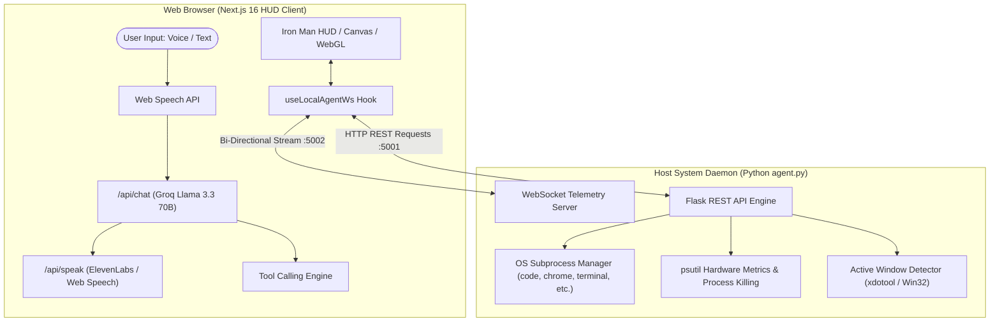

# J.A.R.V.I.S. — AI Voice Assistant & Real-Time OS Desktop Agent

[](https://nextjs.org/)
[](https://react.dev/)
[](https://www.python.org/)
[](https://flask.palletsprojects.com/)
[](https://groq.com/)
[](LICENSE)

An advanced, Iron Man-inspired **AI Voice Assistant & Interactive System HUD**. Combines a Next.js 16 frontend featuring real-time WebGL canvas visualizers with a Python desktop IPC daemon (`agent.py`) for low-latency desktop application control, process monitoring, and real-time hardware telemetry streaming.

🔗 **Live Interface Demo:** [jarvis-theta-indol.vercel.app](https://jarvis-theta-indol.vercel.app)

---

## 📐 System Architecture

Browsers operate within strict security sandboxes and cannot directly spawn operating system processes or execute desktop binaries. **J.A.R.V.I.S.** bridges this boundary using a dual-layer architecture:

1. **Frontend HUD (Next.js 16 / React 19)**: Handles speech recognition, streaming AI logic, Web Audio synthesis, WebGL visualizers, and interactive state management.
2. **Local IPC Agent Daemon (`agent.py`)**: A Python background process providing low-latency **WebSocket telemetry streaming (`ws://localhost:5002`)** and a **REST execution API (`http://localhost:5001`)** for OS-level control.



---

## ✨ Key Features

### 🎙️ Multimodal AI & Voice Engine
* **Hands-Free Wake-Word Detection**: Supports always-on listening ("Wake up JARVIS") and spoken sleep directives ("JARVIS sleep").
* **Streaming AI Tool Calling**: Powered by Groq Llama 3.3 70B with real-time web search integration (Serper API), live weather fetch (`wttr.in`), and Wikipedia lookups.
* **Low-Latency Voice Synthesis**: Fluid voice responses using ElevenLabs TTS with fallback to browser native SpeechSynthesis.

### 🖥️ Real-Time Desktop Control & Telemetry (IPC Agent)
* **OS Application Launching**: Auto-detects local installed apps (`code`, `google-chrome`, `firefox`, `gnome-terminal`, `vlc`, `nautilus`, `telegram-desktop`) and launches them on request.
* **Live System Metrics Stream**: 1-second interval WebSocket stream for CPU %, RAM %, Disk %, uptime, and active window detection.
* **Process Monitor & Process Killing**: View top consuming processes and terminate stuck PID processes directly from the HUD.

### 🎨 Cinematic Sci-Fi HUD & Audio Synthesis
* **3D Arc Reactor & Canvas Visualizers**: Dynamic WebGL core reactor and real-time FFT-like audio waveform canvas animations.
* **Zero-Asset Web Audio API Sound Generator**: UI click feedback, access-granted tones, and mechanical boot sounds synthesized directly in code (0 external audio assets).
* **Persistent Layout Engine**: Drag-and-drop dashboard panels with automatic layout versioning and `localStorage` state persistence.

---

## 🛠️ Tech Stack

| Category | Technology |
|---|---|
| **Frontend Framework** | Next.js 16 (App Router), React 19, Tailwind CSS |
| **Graphics & Audio** | Canvas 2D API, Web Audio API, SVG Animation |
| **LLM & Tool Orchestration** | Groq API (`llama-3.3-70b-versatile`), Serper API, wttr.in |
| **Voice Pipelines** | Web Speech API, ElevenLabs Speech API |
| **Agent Daemon** | Python 3.12, Flask, Flask-CORS, `psutil`, `websockets` |
| **Protocol** | WebSockets (IPC Telemetry :5002), HTTP REST (Command Execution :5001) |

---

## 🚀 Getting Started

### 1. Clone the Repository
```bash
git clone https://github.com/nilanjanajui/jarvis.git
cd jarvis
```

### 2. Frontend Setup
Install dependencies:
```bash
npm install
```

Create a `.env.local` file in the root directory:
```env
GROQ_API_KEY=your_groq_api_key_here
SERPER_API_KEY=your_serper_api_key_here
ELEVENLABS_API_KEY=your_elevenlabs_api_key_here
```

Start the Next.js dev server:
```bash
npm run dev
```

### 3. Desktop Agent Daemon Setup (Optional for Local OS Control)
To enable desktop app launching, live RAM/CPU metrics, and process control:

```bash
# In a new terminal window
python3 -m venv jarvis-env
source jarvis-env/bin/activate    # On Windows: jarvis-env\Scripts\activate

pip install flask flask-cors psutil websockets
python agent.py
```

Open `http://localhost:3000` in Google Chrome or Microsoft Edge.

> **Note:** When accessing via `http://localhost:3000`, the web HUD automatically establishes a WebSocket connection to `ws://localhost:5002`, displaying **`● WS IPC STREAM`** in green on the HUD status bar.

---

## 🗣️ Voice & Tool Commands

| Command | Action Performed |
|---|---|
| *"Wake up JARVIS"* | Triggers mechanical audio boot sequence & voice greeting |
| *"JARVIS sleep"* | Suspends always-on voice recognition |
| *"What is the weather in Tokyo?"* | Fetches live meteorological data via location API |
| *"Open VS Code"* | Sends REST IPC request to `agent.py` to spawn `code` process |
| *"Open Chrome"* | Launches Google Chrome binary on host system |
| *"What is 847 multiplied by 29?"* | Evaluates expression via built-in HUD Calculator tool |
| *"Set a timer for 15 minutes"* | Initializes countdown widget with native browser notifications |

---

## 🔒 Security & Privacy

* **Local Sandboxing**: `agent.py` strictly binds to `127.0.0.1` / `localhost` and is never exposed to external network interfaces.
* **Destructive Command Filters**: Shell execution endpoints filter high-risk root destruction strings.
* **Graceful Fallback**: Browsers visiting the hosted Vercel link without `agent.py` running function fully for AI conversation, voice TTS, weather, calculator, and timers without crashing.

---

## ⚠️ Troubleshooting: Why Vercel says "Agent Offline"

If you visit the **live Vercel link** (`https://...`), the desktop control features will show as "Agent Offline". This is because of fundamental web security rules, not a bug in the code:

1. **Mixed Content Blocking**: The live site is served securely over **HTTPS**. The local Python agent runs insecurely on plain **HTTP/WS** (`http://localhost:5001`). Modern browsers (Chrome, Safari, Firefox) strictly block secure websites from making unencrypted requests to prevent eavesdropping and data injection.
2. **Localhost Isolation**: `localhost` refers to the computer of the person *viewing* the website. When a recruiter or friend opens the Vercel link, their browser looks for `agent.py` on *their* laptop or phone, where it isn't running.

**How to test Desktop Control:**
Always use `http://localhost:3000` (run `npm run dev`) alongside `agent.py`. Since both run over local HTTP, the browser allows the connection perfectly without security warnings!

---
## 📜 License

Distributed under the MIT License. See `LICENSE` for more information.